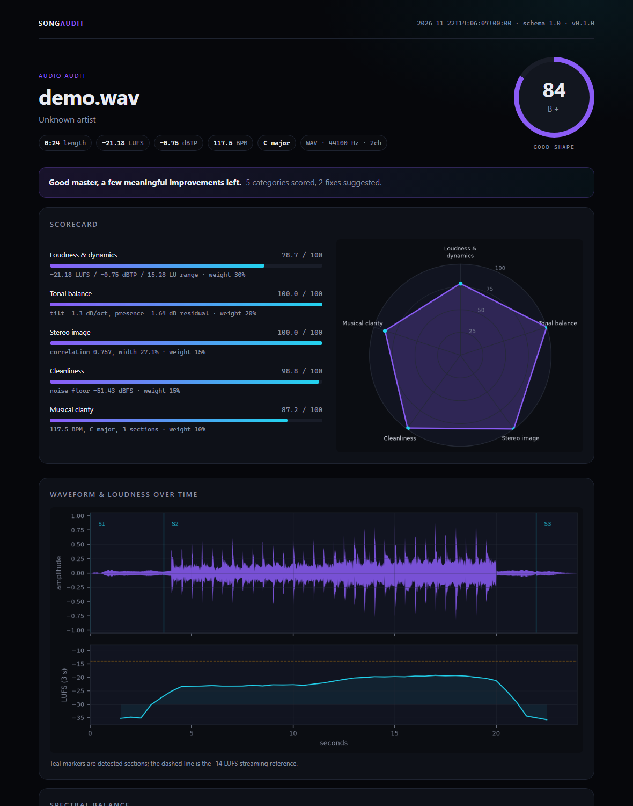

# SongAudit

**Drop a track in. Get the full audit back.**

SongAudit is an open-source audio QA pipeline for any song - especially AI-generated ones.
It decodes the file, measures it against real mastering and musical criteria, scores it, and
returns a self-contained report with a prioritized fix list.

No microphone. No virtual audio cable. No plugins. The audio never leaves the machine.

---

## What it measures

| Area | Signals |
| --- | --- |
| Loudness & dynamics | Integrated LUFS (ITU-R BS.1770-4), loudness range, short-term timeline, crest factor, micro-dynamics |
| Peaks | Sample peak, 4x oversampled true peak, clipped sample count, longest clip run |
| Stereo | Correlation, side/mid ratio, mono fold-down loss, channel balance, width |
| Tonal balance | Octave-band energy, fitted tilt, per-band deviation, spectral centroid, rolloff, flatness |
| Source quality | High-frequency cutoff (lossy transcode hint), DC offset, quiet-passage floor, edge silence |
| Music | Tempo + confidence, key + confidence (Krumhansl), tuning drift, chroma-based sections with per-section RMS |
| Vocals | Optional faster-whisper transcript, vocal coverage, words per minute, phrase repetition |

Every measurement is either a published method (BS.1770, true-peak oversampling, Krumhansl profiles)
or an explicitly labelled heuristic (section boundaries, "harsh"/"muddy" residuals).

## What you get back

- **A grade** - weighted 0-100 score across six categories, letter grade, one-line verdict.
- **Prioritized fixes** - each recommendation says what is wrong, why it matters, and what to change.
- **A single-file HTML report** - charts embedded, dark theme, print friendly, safe to email.
- **report.json** - the same data for dashboards or regression tests.
- **report.md** - a short summary for PRs and issues.

## Quickstart

    git clone https://github.com/ankurhalder/song-audit.git
    cd song-audit
    python -m venv .venv
    .venv\Scripts\activate            # macOS/Linux: source .venv/bin/activate
    pip install -e .

    songaudit audit "C:\path\to\track.mp3" --open

Web app:

    songaudit serve
    # http://127.0.0.1:8000

Drop a file or paste a direct audio URL, wait ~10-30 s for a full song, get the report.

## No BlackHole required

BlackHole is a macOS-only virtual audio driver. SongAudit does not use it - and does not need it.

The audit reads the **file** (or a direct audio URL) and decodes it. Nothing is played, nothing is
recorded, so no input or output device is involved at all.

If you specifically need to capture what a browser is playing, here is the platform reality:

| Need | macOS | Windows |
| --- | --- | --- |
| Virtual loopback driver | BlackHole | not needed: WASAPI loopback is built in |
| Audacity recording | select BlackHole as input | Host = **Windows WASAPI**, device = **Speakers (loopback)** |
| SongAudit capture | install BlackHole first | songaudit capture works out of the box |

The Windows equivalent of BlackHole is the WASAPI loopback of the default speaker. Audacity exposes
it directly as a recording device, and songaudit capture uses the same API:

    songaudit capture --audit

That records the digital stream (no mic, no room noise) and runs the audit on the result.

Suno share pages are rendered client-side and do not expose the audio file to any server-side tool,
so paste-the-link does not work for them. Download the track from Suno (or use capture), then drop
the file in. This is also the honest way to respect their terms.

## CLI

    songaudit audit <file|url> [-o OUT] [--lyrics] [--json] [--open]
    songaudit serve [--host 127.0.0.1] [--port 8000]
    songaudit capture [--output take.wav] [--seconds N] [--device NAME] [--audit]

Examples:

    songaudit audit "D:\music\demo.wav"
    songaudit audit https://example.com/track.mp3 --json > report.json
    songaudit audit track.flac --lyrics --open

## Scoring

| Category | Weight | What moves it |
| --- | --- | --- |
| Loudness & dynamics | 30% | -14 LUFS target, -1 dBTP ceiling, zero clipping, 6-12 LU loudness range |
| Tonal balance | 20% | octave-band residuals <= 5 dB from the track's own tilt, no early top-octave cutoff |
| Stereo image | 15% | correlation in a healthy band, mono fold-down loss < 3 dB, real width |
| Cleanliness | 15% | quiet passages below -60 dBFS, no DC offset, no dead air at the edges |
| Musical clarity | 10% | confident tempo and key, in-tune material, 3-8 sections |
| Vocal & lyrics | 10% | vocal coverage and a natural words-per-minute range (only with --lyrics) |

Grades: A+ >= 95, A >= 90, A- >= 85, B+ >= 80, B >= 75, B- >= 70, C+ >= 65, C >= 60, D >= 50, F below.

A master more than 6 LU away from the -14 LUFS streaming reference is capped at B+, and more than
10 LU away at B-, however clean everything else measures.

Targets are streaming-oriented. Club and vinyl deliveries want different loudness; the report says so
rather than pretending one target fits everything.

## API

| Method | Route | Purpose |
| --- | --- | --- |
| GET | / | upload form |
| POST | /audit | multipart upload or direct URL -> 303 to the report |
| GET | /report/{id} | HTML report |
| GET | /report/{id}/json | measurements as JSON |
| GET | /healthz | liveness |

The engine is importable too:

    from songaudit.pipeline import audit_file
    report = audit_file("track.wav")
    print(report["score"]["grade"])

## Docker

    docker compose up --build
    # http://127.0.0.1:8000

Jobs are written to the songaudit-data volume. Change SONGAUDIT_MAX_UPLOAD_MB to raise the 100 MB cap.

## Architecture

    source file / URL / loopback
        -> ingest     (download, validate, tag read)
        -> decode     (libsndfile -> stereo float32, 44.1 kHz)
        -> analysis   (mastering, stereo, spectral, music, optional lyrics)
        -> score      (weighted rubric + recommendations)
        -> report     (HTML + JSON + Markdown, charts as base64)

More detail in [docs/ARCHITECTURE.md](docs/ARCHITECTURE.md).

## Development

    pip install -e ".[dev]"
    pytest

Tests build their audio procedurally (clicks, chords, clipped tones), so the repo carries no
copyrighted media. Optional extras: pip install -e ".[lyrics]" for Whisper, ".[fetch]" for yt-dlp.

## Privacy

Uploads, downloads and reports live under data/ (gitignored) and are never sent anywhere.
The web app binds to 127.0.0.1 by default.

## Limits

- Not a plagiarism or AI-detection tool. It measures the signal, not the provenance.
- Section labels are heuristic; a human arrangement still wins.
- Transcription is only as good as Whisper on a sung mix.
- The rubric is streaming-first and genre-agnostic. Use it as a second pair of ears, not a verdict.

## License

MIT - see [LICENSE](LICENSE).
